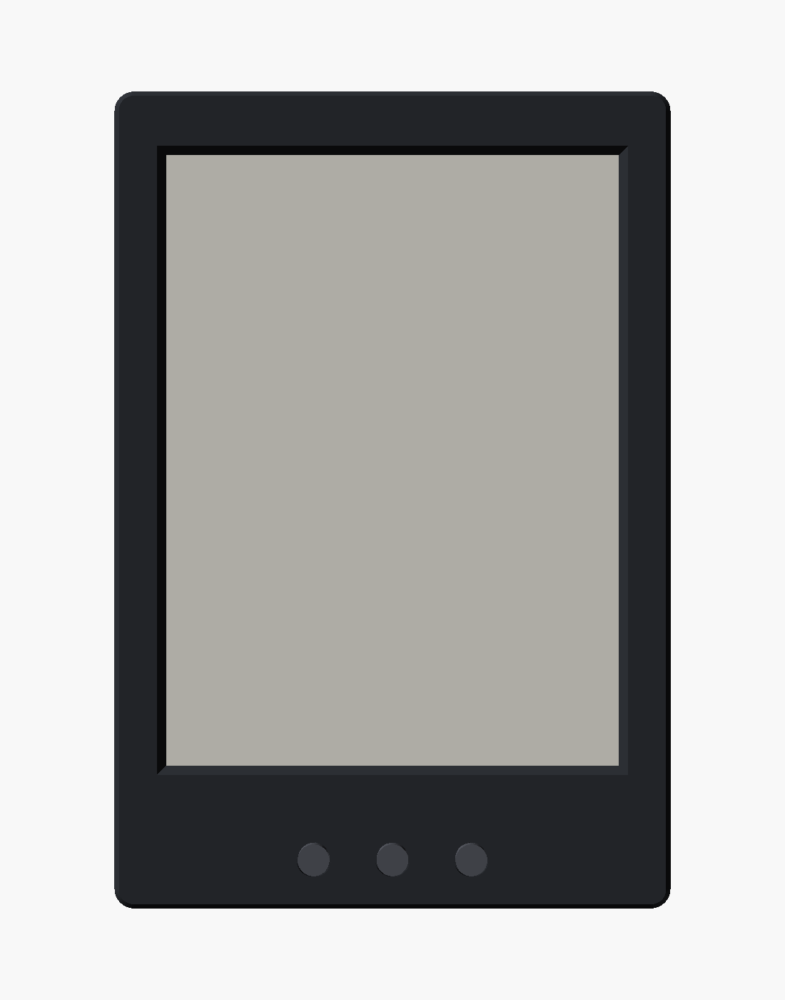
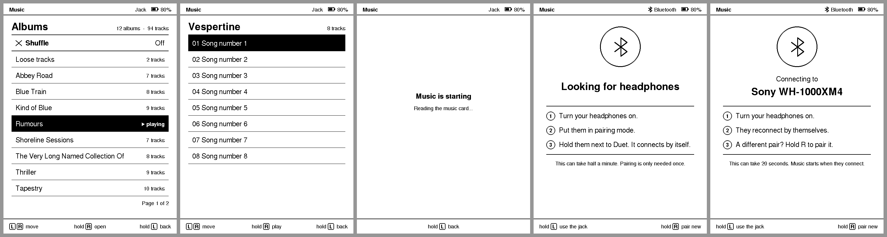

# Duet

An open-source, 3D-printed, Kindle-sized **e-ink reader and MP3 player**. A Soldered
Inkplate 6 shows the books; an Adafruit HUZZAH32 plays your MP3s to a headphone jack
or Bluetooth headphones. No phone, app or account.


| | |
|---|---|
|  |  |

**Status: v0.5, work in progress.** The reader runs on hardware. The audio firmware
and the latest case revision haven't been tested on hardware yet. See
[docs/testing.md](docs/testing.md) for exactly what has and hasn't been checked.

## Start here

| I want to… | Go to |
|---|---|
| Build one | [docs/build-guide.md](docs/build-guide.md): parts, printing, wiring, assembly |
| Flash the firmware | [firmware/README.md](firmware/README.md) |
| Load books and music, learn the controls | [docs/using-duet.md](docs/using-duet.md) |
| Change the case | [hardware/README.md](hardware/README.md) |
| See what changed between versions | [CHANGELOG.md](CHANGELOG.md) |

## What's in this repository

```
firmware/
  duet-reader/        Inkplate 6 sketch: books, page keys, music browser
  duet-audio/         HUZZAH32 sketch: MP3 → headphone jack or Bluetooth
  shared/duet_link.h  master copy of the I2C protocol between the two boards
hardware/
  case/               parametric OpenSCAD case (duet-case.scad)
  case/stl/           ready-to-print parts, exported from the .scad
  case/print/         Bambu Studio print project
brand/                logo (SVG, PNG) and its Sketch source
docs/                 build guide, user guide, test status, images, blog posts
tools/                scripts: re-export the STLs, sync the protocol header
CHANGELOG.md          what changed in each version
```

## Working on Duet

- **One source of truth per thing.** Edit `hardware/case/duet-case.scad`, then run
  `tools/export-case.sh` and commit the STLs with it. Edit
  `firmware/shared/duet_link.h`, then run `tools/sync-link.sh`. A GitHub check fails
  if the two firmware copies drift apart.
- **Versions are Git tags, not folders.** Each release is tagged (`v0.5`, `v0.6`, …)
  and logged in [CHANGELOG.md](CHANGELOG.md). Note changes under *Unreleased* as you
  make them. To get an old version back, check out its tag or download it from the
  GitHub tags page; there's no need for copied `archive/` folders.
- **Firmware version** is `DUET_VERSION` in `duet-reader.ino`. Bump it when you tag.

## Licence

Firmware and case are [GNU GPL v3.0](LICENSE). Bundled third-party files keep their own
licences: the fonts in `firmware/duet-reader/Fonts/` are GNU FreeFont (GPL with font
exception) and `firmware/duet-reader/src/inflate/` is the inflate half of miniz (MIT,
notice in the file).
