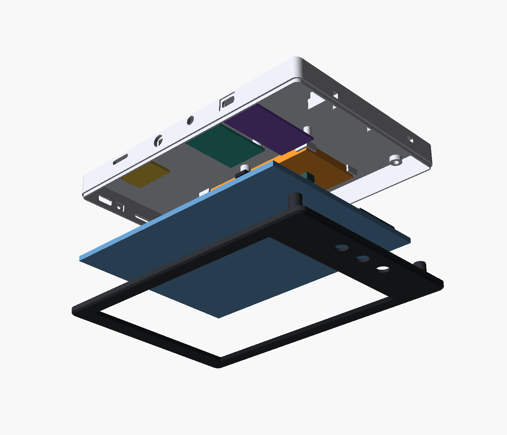
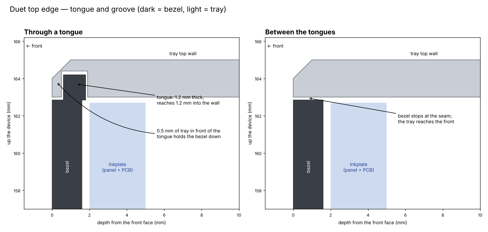
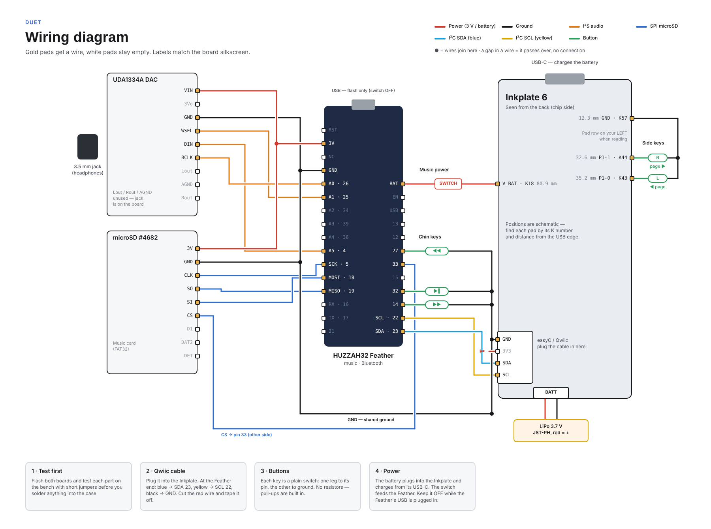
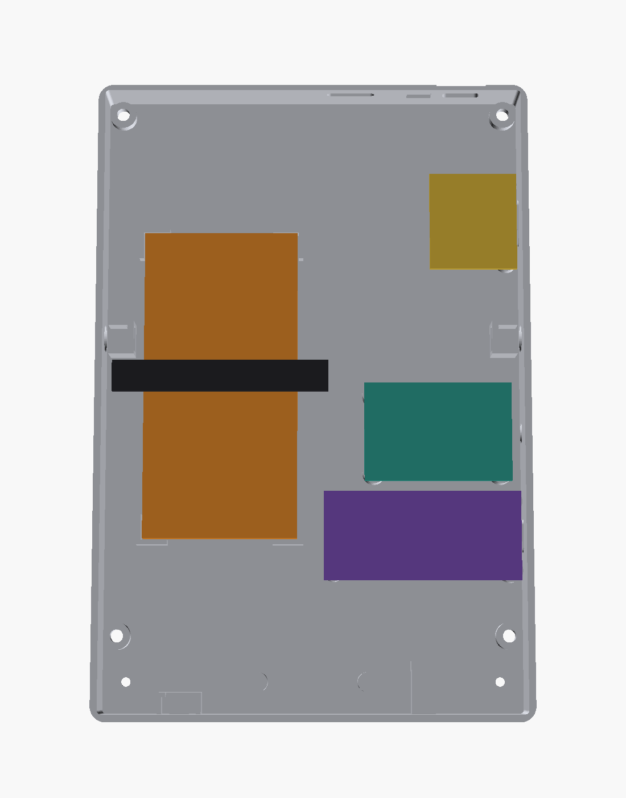

# Build guide

The Duet is a Kindle-sized reader in the Folio case design, built on a Soldered
**Inkplate 6**, with a second ESP32 (Adafruit **HUZZAH32**) that plays MP3s to a
**headphone jack or Bluetooth headphones**. The case is parametric OpenSCAD, about
**112 × 165 × 17 mm**.

Nothing inside is held by tape or glue: every board screws onto **M2.5 heat-set
insert standoffs** printed into the back tray, the battery sits in a printed cradle
under a screwed-down strap, and the switches drop into printed pockets.

## 1. Print the fit test first (≈15 min)

`hardware/case/stl/duet-fit_test.stl` holds two strips: the top 14 mm of the back
tray and the top 14 mm of the bezel. Push the bare Inkplate into the tray strip and
check that the **USB-C**, **microSD slot** and **power button pin hole** line up.
Then slide the bezel strip's two tongues into the tray strip's top wall. They should
go in by hand with a little drag and no wobble front-to-back. If they're too tight,
raise `tongue_fit` (0.1 → 0.15); if they're loose, lower it. If the ports are off,
change `stack`, `pcb_back` or the `*_z` values in `hardware/case/duet-case.scad` and
re-export (see [hardware/README.md](../hardware/README.md)).

Measure these with calipers before the full print:

| Measure | Variable | Default |
|---|---|---|
| Panel front → back end of the Inkplate's M3 standoffs | `stack` | 10.0 |
| Panel front → back of the Inkplate PCB | `pcb_back` | 3.0 |
| Height of the DAC's headphone jack above its PCB | `dac_tall` | 5.5 |
| Your battery's thickness (the strap clamps to exactly this) | `batt_t` | 5.0 |
| Hole size your M2.5 inserts ask for | `ins25_d` | 3.6 |
| How far the screen window sits above the board centre | `window_dy` | 5.0 |

## 2. Print settings

| Part | Orientation (as exported) | Notes |
|---|---|---|
| `duet-bezel.stl` | Face down | Textured PEI gives a matte, Kindle-like front. No supports. The two top tongues overhang 1.2 mm; that prints fine without support. |
| `duet-tray.stl` | Back down | No supports. Standoffs, pockets and cradle all grow up from the bed. |
| `duet-keys.stl` | Flat | 3 chin keys, 2 side keys, the WAKE plunger and the battery strap. The keys have icons sunk 0.5 mm into their tops and square flanges so they can't turn; use a 0.4 mm nozzle or smaller and 0.1–0.15 mm layers for crisp icons. The two skip keys are the same part: fit one turned round. |
| `duet-fit_test.stl` | As exported | Tray strip back down, bezel strip face down. Checks the ports and the top tongues. |

PETG or PLA+, 0.2 mm layers, **4 walls** (gives the insert standoffs solid plastic to
melt into), 20 % infill.

## 3. Parts and hardware

**Boards:** Soldered Inkplate 6, Adafruit HUZZAH32 Feather, Adafruit UDA1334A I2S DAC,
Adafruit #4682 microSD breakout, a 3.7 V LiPo with a JST-PH plug, a Qwiic cable.

| Part | Qty | Where |
|---|---|---|
| M2.5 heat-set inserts, ~4 mm long (hole size → `ins25_d`) | 10 | Feather 2, DAC 4, microSD 2, battery strap 2 |
| M2.5 × 5 mm button-head screws | 10 | Same places |
| M3 × 6 mm screws | 4 | Tray → the Inkplate's own standoffs |
| M2 heat-set inserts (3.2 mm hole, 4 mm long) | 2 | Bezel chin bosses |
| M2 × 12 mm countersunk screws | 2 | Bezel → tray |
| 6 × 6 × 5 mm tactile switches | 5 | 3 chin, 2 side |
| SS12D00-style slide switch | 1 | Audio power |
| 0.5 mm foam strip | 1 | Gasket around the screen window only |

The microSD breakout is **Adafruit #4682** (3 V only), which has two M2.5 holes. The
older #254 has 2.2 mm holes and won't take these screws.

## 4. Wiring

Pin numbers match the firmware. Before soldering anything into the case, do the
I2C bench check in [testing.md](testing.md#bench-check-before-you-solder-the-music-switch).

## 5. Assembly order

1. **Inserts.** Press the 10 M2.5 inserts into the tray standoffs and the 2 M2 inserts into the bezel chin bosses (iron at ~220 °C for PETG; let the insert sink under its own weight, finish flush).
2. **WAKE plunger.** Drop it into its guide tube from inside the tray, stop flange toward the board.
3. **Side keys.** Put a printed key through each side hole from inside, then press a 6 × 6 switch into the pocket behind it, plunger against the key. Legs go through the slot in the pocket's back.
4. **Slide switch.** Press it into the pocket behind the bottom-edge slot, lever through the slot.
5. **Chin keys.** Solder the three chin switches to a perfboard strip ~42 × 12 mm at 15.9 mm spacing. It's clamped between the bezel and the two tray pillars when the bezel goes on.
6. **Audio boards, face-down.** Each board mounts *components toward the back of the case*, flat side toward the Inkplate:
   - **Solder wires before mounting, from the component side**, and trim the legs flush on the flat side. The flat side has only 0.8 mm of clearance to the Inkplate.
   - microSD board (top right): card edge to the side slot, 2 screws.
   - DAC (middle right): jack to the side hole, 4 screws.
   - Feather (bottom right): USB to the side slot. 2 screws at the USB end; the two printed pins at the far end go through its small holes.
7. **Battery.** Lay it in the cradle, leads toward the bottom, and screw the strap across it (2 screws, heads sit in the strap's counterbores).
8. **Wiring** per the diagram above. Cut the red 3.3 V wire of the Qwiic cable. Keep the two page-key wires routed along the walls, not under the boards.
9. **Inkplate.** Plug in the battery and the Qwiic cable, then screw the board to the tray (4 × M3 from the back), screen facing out.
10. **Bezel.** Foam strip around the window. Lay the bezel on about 1.5 mm low, press it flat, and slide it up until its two top tongues seat in the tray's top wall. Then put the 2 × M2 screws in the chin. The screws stop it sliding back down, so the top can't lift. To open it, take out the screws, slide the bezel down, and lift it off.

Next: [flash the firmware](../firmware/README.md), then [load books and music](using-duet.md).
