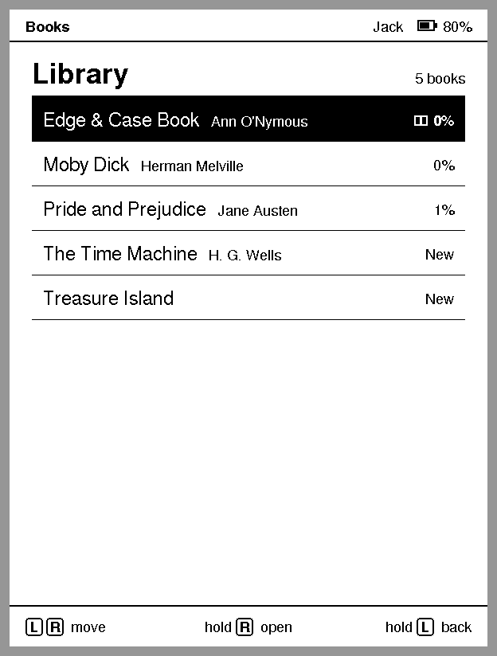
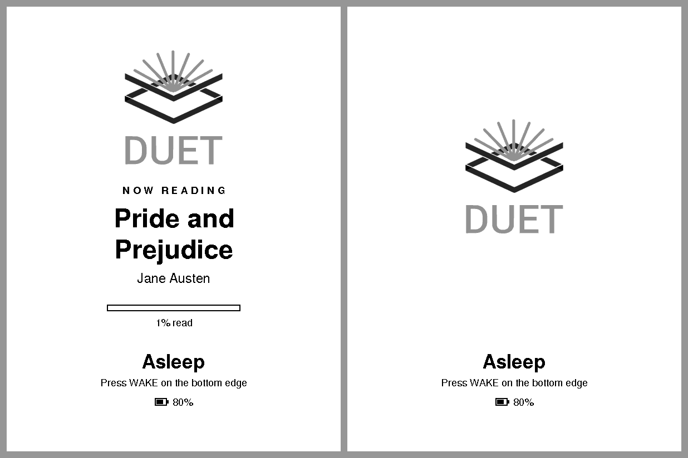

# Using Duet

## Cards

Format both cards FAT32.

```
Book card (Inkplate, top edge)     Music card (#4682, right side)
/books/                            /music/Album name/01 Song.mp3   ← each folder is an album
  Moby-Dick.epub                   /music/Artist/Album/01 Song.mp3 ← up to 3 folders deep
  Some Notes.txt                   /music/Loose song.mp3
  .duet    (auto: bookmark)        /bt.txt   ← optional, one line: the start of your headphones'
  .cache/  (auto: converted EPUBs            Bluetooth name. Only if Duet pairs with the wrong device.
            + page indexes — safe to delete)
```

## Books

The reader opens **EPUB** (DRM-free: Standard Ebooks, Project Gutenberg, most indie
stores) and plain-text `.txt`. The first time you open a book it is prepared once: an
EPUB is unpacked into reading text, then every book gets a page index. Expect a few
seconds to about half a minute for a long novel, with a progress screen; after that it
opens instantly and paging back is as fast as paging forward. Chapters start on a new
page and headings are bold and centred.

The built-in fonts are plain ASCII, so accented letters show without their accents
(é → e) and images are skipped. Books bought from Kindle, Apple or Kobo are
DRM-protected and will show "This book is DRM-protected".



## Music

Up to 600 MP3s in up to 200 folders. Tracks play in name order, album after album; a
track number at the front of a file name (`07 - Song.mp3`) sets the order and is left
off the title on screen. Shuffle plays every track once in a random order, so ◀◀
really goes back. Bluetooth needs **44.1 kHz stereo** MP3s; mono or 48 kHz files play
at the wrong speed there (they are fine on the headphone jack).

## Bluetooth

Switch the output to Bluetooth in Settings (or hold ▶‖ for 2 s). The first time, put
your headphones in pairing mode and hold them next to Duet: it pairs with the first
pair within about arm's length, and only after 45 s with anything further away, so it
doesn't grab a TV or speaker across the room. From then on it reconnects by itself
whenever the headphones are on. Connecting takes 15–25 s (most of it is a fixed wait
inside the Bluetooth library), and the music starts by itself. The play, pause and
skip buttons on the headphones work.

## Controls

| Where | Tap L / R | Hold L | Hold R |
|---|---|---|---|
| Reading | Page back / forward | Library | Now playing |
| Home, Library, Albums, Tracks, Settings | Move up / down | Back one level | Open / play / change |
| Now playing | Previous / next track | Albums and tracks | — |
| Bluetooth connecting screen | — | Use the headphone jack | Pair new headphones |

Hold **both** side keys anywhere for Home. A tap made while the page is still
redrawing is kept and acted on next (set `CATCH_TAPS_DURING_REFRESH` to `false` in the
reader sketch if pages ever turn by themselves).

| Key | Short press | Hold |
|---|---|---|
| ◀◀ ▶‖ ▶▶ (chin) | Previous (restarts the track if more than 3 s in) / play-pause / next | ◀◀ ▶▶ = volume, ▶‖ 2 s = jack ↔ Bluetooth |
| WAKE (bottom edge) | Wake from sleep | — |
| Pin hole (top edge) | Inkplate power button | — |


